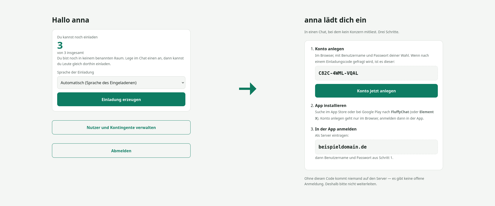

[English](README.md) | **Deutsch**

# Humatrix

Ein Matrix-Server für Familie, Verein oder Freundeskreis, in einem Durchgang auf einem
frischen Debian-Rechner aufgesetzt. Der Installer richtet Synapse, Element Web, coturn,
nginx und eine Sicherung ein und ergänzt eine Einladungsseite, über die normale Nutzer
Leute hereinholen, ohne dass alles über den Verwalter läuft.

```bash
sudo ./install.sh --domain deinedomain.de --mail du@example.de --verwalter dein-name
```

Danach heißen eure Kennungen `@anna:deinedomain.de`. Nachrichten sind Ende zu Ende
verschlüsselt, auf dem Server liegt nur Chiffrat. Was der Betreiber sehen kann und was
nicht, steht unter [Was der Betreiber sehen kann](#was-der-betreiber-sehen-kann).

<p align="center">
  
</p>

<p align="center"><sub>Links: ein Nutzer erzeugt eine Einladung. Rechts: was der Eingeladene sieht.</sub></p>

---

## Läuft das bei mir?

| | |
|---|---|
| **Betriebssystem** | Debian 13 (empfohlen) oder Debian 12. Nichts anderes. |
| **Architektur** | `amd64`. Kein ARM. |
| **Arbeitsspeicher** | 2 GB Minimum, 4 GB für 20–50 Leute, 8 GB mit Reserve |
| **Plattenplatz** | 20 GB Minimum, 80 GB empfohlen; Fotos und Videos wachsen |
| **Eigene Domain** | zwingend; sie wird Teil jeder Kennung und lässt sich später nicht ändern |
| **Öffentliche IPv4** | zwingend; bei DS-Lite-Anschlüssen geht es nicht |
| **Zugang** | root (oder `sudo`) auf einem Server, der nur dafür da ist |

### Was nicht geht

**Raspberry Pi und andere ARM-Rechner.** `packages.matrix.org` führt Synapse nur für
`amd64` und `i386`. Matrix auf einem Pi heißt Synapse im Container oder aus dem
Quelltext, und beides macht dieser Installer nicht. Er bricht zu Beginn mit dieser
Begründung ab.

**Windows.** Der Installer ist ein Bash-Skript und baut auf `systemd`, `apt` und
Unix-Dateirechten auf. WSL ist keine sinnvolle Grundlage für einen Server, der den
ganzen Tag laufen soll.

**Ubuntu, vorerst.** matrix.org liefert Pakete für Ubuntu (focal, jammy, noble), und
vermutlich liefe es, aber es ist nicht geprüft worden, deshalb weist der Installer
Ubuntu ab. Wer es ausprobiert hat: ein Issue genügt, dann steht es hier als geprüft.

**Ein Server, auf dem schon etwas anderes läuft.** Der Installer braucht die Web-Ports,
einen `nginx` und eine PostgreSQL-Datenbank für sich. Steht dort schon ein Webserver,
bricht er ab. Ist das ein Reverse-Proxy, nimm `--hinter-proxy` (siehe Installation).

### Erfülle ich das?

```bash
. /etc/os-release && echo "$PRETTY_NAME"      # Debian 12 oder 13?
dpkg --print-architecture                      # muss amd64 sagen
free -g; df -h /                               # Speicher und Platz
```

Der Installer prüft das alles vor seiner ersten Änderung noch einmal, samt DNS und
Ports, und bricht ab, ohne etwas angefasst zu haben, wenn etwas fehlt. Einzige
Ausnahme: ein fehlendes `curl` wird vorher installiert, die Prüfung braucht es.

---

## Warum es das gibt

Einen Matrix-Server von Hand aufzusetzen heißt, die Anleitungen von fünf Projekten
abzuarbeiten und die Anruf-Konfiguration mindestens einmal falsch zu machen.

Wenn er läuft, fehlt immer noch etwas: Matrix kennt keine Einladungen durch normale
Nutzer. Registrierungs-Token darf nur der Serververwalter erzeugen, also muss jedes
neue Familienmitglied über die eine Person laufen, die den Server kennt. Humatrix
ergänzt genau dieses Stück.

## Was es ist

- **Ein Befehl** für die ganze Einrichtung, jederzeit wiederholbar
- **Einladungen für alle**: Jeder Nutzer bekommt ein Kontingent und verschickt Links
- **Einladungen bringen einen Raum mit**: Beim Erzeugen wählst du den Raum, in dem die
  Person landen soll. Getrennte Kreise auf demselben Server bleiben getrennt.
- **Nachvollziehbare Einladungskette**: Zu jedem per Einladung geholten Konto zeigt die
  Verwaltung, wer es geholt hat. Matrix selbst verrät nicht, wer einen Link benutzt
  hat, deshalb ordnet der Dienst über den Anmeldezeitpunkt zu, und nur, wenn genau ein
  Konto in Frage kommt. Sonst gilt die Einladung als **eingelöst, Zuordnung unklar**:
  Das Kontingent bleibt verbraucht, der Link ist verbrannt, und der Neue bekommt keine
  automatische Raumeinladung, ihn lädt man im Chat von Hand ein. Die Zuordnung wird bei
  jedem Durchlauf erneut versucht und kann später gelingen, wenn die anderen Kandidaten
  zugeordnet sind. Zwei Neulinge in derselben Minute über zwei Links bleiben dauerhaft
  unklar; eine Lücke ist besser als ein falscher Eintrag. Von Hand angelegte Konten und
  das Verwalterkonto haben keinen Ketteneintrag.
- **Zurückziehen**: Eine offene Einladung lässt sich mit dem ✕ an ihrer Zeile
  zurückziehen. Der Code wird beim Server gelöscht, der Link meldet „zurückgezogen“,
  das Kontingent ist wieder frei.
- **Abmelden** auf der Einladungsseite beendet alle Sitzungen dieses Kontos dort, auch
  auf anderen Geräten.
- **Vernünftige Voreinstellungen**: Verschlüsselung an, Registrierung nur per Einladung,
  keine Link-Vorschauen, zwischengespeicherte Medien fremder Server nach 90 Tagen geräumt
- **Deutsch und Englisch**: `--language en|de` für den Installer (Vorgabe `en`), eine
  Sprachkarte in der Verwaltung, und jede Einladung kann ihre eigene Sprache tragen;
  ohne eine folgt die Einladungsseite dem Browser des Besuchers. Dokumentation und
  Kundenanleitung gibt es in beiden Sprachen.
- **Eine Kundenanleitung**, am Ende der Installation erzeugt, mit der echten Adresse,
  dem Kontonamen und dem Startpasswort

## Was es nicht ist

- **Kein WhatsApp-Ersatz.** Eure Leute müssen bewusst wechseln. Das klappt im eigenen
  Kreis, nicht für alle.
- **Kein Mehrmandanten-Betrieb.** Ein Server, eine Gemeinschaft.
- **Keine neue Verschlüsselung.** Das macht alles Matrix. Hier wird nichts
  Kryptografisches geschrieben.
- **Keine eigene App.** Ihr nutzt die aus den Stores. So ist auch nicht dieselbe Person
  für App und Server zuständig.
- **Kein Produkt mit Rund-um-die-Uhr-Betreuung.** Ein gepflegtes Nebenprojekt.

## Voraussetzungen

Die Eckdaten stehen oben unter [Läuft das bei mir?](#läuft-das-bei-mir). Dazu:

| | |
|---|---|
| Server | Debian 13 (oder 12), amd64, **4 Kerne, 8 GB RAM, 80 GB** für 20–50 Leute |
| Domain | eine eigene; sie wird Teil jeder Kennung |
| DNS | sechs A-Einträge (siehe unten) |
| Zuhause? | Geht, aber viele Anschlüsse haben keine eigene öffentliche IPv4 (DS-Lite). Der Installer sagt es dir. |
| Schon ein Proxy da? | `--hinter-proxy` benutzen (siehe Installation). |

Die Domain lässt sich später nicht ändern, ohne alle Konten neu anzulegen.

### DNS

```
deinedomain.de              A   <IP>
matrix.deinedomain.de       A   <IP>
chat.deinedomain.de         A   <IP>
invite.deinedomain.de       A   <IP>
service.deinedomain.de      A   <IP>
turn.deinedomain.de         A   <IP>
```

## Installation

Auf einem frischen Server fehlt `git`, also auf dem eigenen Rechner klonen und den
Ordner hinüberkopieren:

```bash
git clone https://github.com/Gekons/Humatrix.git     # auf deinem Rechner
scp -r Humatrix root@<IP>:/root/
ssh root@<IP>                                         # ab hier auf dem Server
cd /root/Humatrix
./install.sh --domain deinedomain.de --mail du@example.de --verwalter dein-name
```

Mit Sicherung auf einen entfernten Speicher:

```bash
sudo ./install.sh --domain deinedomain.de --mail du@example.de --verwalter dein-name \
                  --sicherung user@storage.example.de:/messenger
```

Der Schlüssel der verschlüsselten Sicherung liegt danach in `/root/.sicherung_passwort`.
Ohne ihn ist keine Sicherung wiederherstellbar, also ins Passwortdepot damit.

Vor der ersten Änderung prüft der Installer System, Arbeitsspeicher, Plattenplatz, alle
sechs DNS-Namen und die Ports und bricht ab, ohne etwas angefasst zu haben, wenn etwas
fehlt. Am Ende laufen zehn Nachkontrollen, mit `--sicherung` elf.

Schalter:

- `--nur <abschnitt>` wiederholt einen einzelnen Abschnitt, z. B. `--nur turn` (siehe `--hilfe`).
- `--betreiber "Name, mail@example.de"` schreibt Name und Erreichbarkeit des Betreuers
  in die Kundenanleitung und in die Hinweise des Einladungsdienstes. Ohne ihn steht dort
  „dein Betreuer“ bzw. „der Betreiber“.
- `--language en|de` legt die Sprache der Installer-Ausgabe, der Webseiten und der
  Kundenanleitung fest. Vorgabe ist Englisch, für einen deutschen Server also
  `--language de` angeben. Die Verwaltung kann die Webseiten später umschalten. Ein
  Wiederholungslauf behält die Sprache der vorhandenen Installation, solange
  `--language` nicht erneut angegeben wird.
- Jeder Schalter hat auch eine englische Schreibweise (`--admin`, `--backup`,
  `--operator`, `--only`, `--behind-proxy`). Abschnittsnamen und Hostnamen-Präfixe
  (`matrix.`, `chat.`, `invite.`, `service.`, `turn.`) sind in beiden Sprachen gleich.

### Schon ein Reverse-Proxy im Haus?

Wenn ein Nginx Proxy Manager, Traefik oder Caddy die Ports 80 und 443 der öffentlichen
Adresse schon belegt:

```bash
sudo ./install.sh --domain deinedomain.de --verwalter dein-name --hinter-proxy
```

In diesem Modus holt der Installer kein Zertifikat und liefert alles als Klartext auf
Port 80 aus; TLS macht der Proxy. Am Ende listet er die fünf Einträge auf, die dort
anzulegen sind. Die DNS-Namen dürfen auf den Proxy zeigen statt auf diesen Server; der
Installer akzeptiert das und meldet es nur.

Einschränkung: TURN über TLS (Port 5349) gibt es so nicht, weil kein Zertifikat auf
dem Rechner liegt. TURN läuft auf 3478. Die Gesprächsinhalte sind ohnehin Ende zu Ende
verschlüsselt; TURN leitet nur Pakete weiter.

## Was danach läuft

| Adresse | für wen |
|---|---|
| `https://chat.deinedomain.de` | alle: Chat im Browser |
| `https://invite.deinedomain.de` | alle: Einladungen verschicken |
| `https://service.deinedomain.de` | nur Verwalter: Konten und Kontingente |
| Handy-App | FluffyChat oder Element X, als Server `deinedomain.de` eintragen (nur anmelden; Konten werden im Browser angelegt) |

### Einladen

<p align="center">
  
</p>

Ein Klick erzeugt einen Link. Er gilt 14 Tage und funktioniert einmal. Der Code
vermeidet verwechselbare Zeichen: `Y9RV-3GZW-JJ57`.

Der Eingeladene legt sein Konto im Browser an (Element Web, der Link führt dorthin);
die Handy-Apps können sich auf diesem Server nur anmelden, nicht registrieren. Danach
installiert er FluffyChat oder Element X und meldet sich mit dem neuen Benutzernamen
und Passwort an.

### Verwaltung

<p align="center">
  
</p>

Kontingent je Person, **0** heißt „darf niemanden einladen“, dazu ein Haken für
unbegrenzt. Konten anlegen, sperren, Passwörter zurücksetzen, Verwalter ernennen. Sperren zieht auch
die offenen Einladungen des Kontos zurück, seine verschickten Links gehen dann nicht mehr.
Und „wer hat wen geholt“, soweit die Zuordnung eindeutig war (siehe oben).

Oben auf der Seite steht, ob Aktualisierungen anstehen (Synapse, Element Web,
Systempakete; täglich geprüft). Eingespielt wird nichts von allein: ein Knopf, dann
eine Rückfrage, die sagt, was passiert und dass der Chat kurz pausiert.

Verwalter ist, wer es am Matrix-Server ist. Es gibt keine zweite Rechteverwaltung und
kein zweites Passwort.

### Zweiter Faktor

<p align="center">
  
</p>

TOTP, zweistufige Anmeldung, Geheimnis verschlüsselt abgelegt, Drossel nach fünf
Fehlversuchen. Scharf wird es erst nach einem gültigen Code, aussperren kann man sich
beim Einrichten also nicht.

Telefon verloren? Als root: `python3 /opt/einladung/einladung.py --zweitfaktor-aus <name>`

## Die Voreinstellungen

| | warum |
|---|---|
| Registrierung **nur per Einladung** | Jedes Konto braucht eine Einladung, und die Kette dahinter ist nachvollziehbar, soweit die Zuordnung eindeutig war. Das begrenzt Missbrauch, nicht die Verschlüsselung. |
| Suche nur **innerhalb geteilter Räume** | Mehrere Kreise auf einem Server (Familie, Verein, Freundeskreis) sehen einander nicht. Bei nur einem Kreis umstellbar in `/etc/matrix-synapse/conf.d/50-eigene.yaml` (nicht in `20-betrieb.yaml`, die schreibt der Installer neu): `user_directory: {enabled: true, search_all_users: true, prefer_local_users: true}`, dann `systemctl restart matrix-synapse`. Siehe [docs/betreiber.md](docs/betreiber.md). |
| Föderation **offen** | Eure Leute erreichen das ganze Matrix-Netz. Das bringt keine fremden Konten auf euren Server. |
| Verschlüsselung **an** für neue Räume | Der Normalfall, kein Sonderfall. |
| Link-Vorschauen **aus** | Sonst ruft der Server fremde Seiten ab und verrät, was jemand verlinkt hat. |
| Nur **Sicherheits**updates automatisch | Alles andere wird täglich geprüft und auf Klick in der Verwaltung eingespielt. |
| Fremde Medien nach **90 Tagen** geräumt | Nur der Zwischenspeicher für Medien anderer Server. Eure eigenen Fotos und Videos bleiben; bei Ende-zu-Ende-Verschlüsselung wäre Löschen Datenverlust. 80 GB einplanen und `du -sh /var/lib/matrix-synapse/media` im Blick behalten (siehe [docs/betreiber.md](docs/betreiber.md)). |

## Was der Betreiber sehen kann

| | |
|---|---|
| Nachrichten, Fotos, Dateien | **nein**; auf dem Server liegt nur Chiffrat |
| Wer wann mit wem | **ja** (Metadaten) |
| Verlauf wiederherstellen | **nein**; die Schlüssel liegen auf den Geräten |
| Passwörter neu setzen | **ja**. Damit ließe sich ein Konto übernehmen und ab dann mitlesen. Alte Nachrichten bleiben verschlossen, und die Geräteprüfung in der App macht so einen Versuch sichtbar (siehe [SECURITY.de.md](SECURITY.de.md)). |
| Web-Client im Browser | Der Betreiber liefert den Client-Code aus (`/var/www/element`) und könnte ihn verändern; im Browser schützt die Verschlüsselung also nicht gegen den Betreiber. Wem das wichtig ist, der nimmt die Handy-App aus dem Store. |

Nachprüfen: `su - postgres -c "psql synapse"` und in die Ereignistabelle schauen.

## Betrieb

| Was | Wie oft |
|---|---|
| Sicherheitsupdates | automatisch |
| Alles andere (Systempakete, Synapse, Element Web) | täglich geprüft, in der Verwaltung angezeigt, auf Klick nach Rückfrage eingespielt. Synapse startet neu, der Chat ist kurz nicht erreichbar. |
| Synapse von Hand | `apt update && apt install matrix-synapse-py3`, oder als root `messenger-update-ausfuehren.sh`, das alles einspielt, was die Prüfung gemeldet hat |
| Element Web von Hand | `./install.sh --domain … --mail … --nur element`; holt nur, wenn eine neuere Fassung vorliegt. Der Browser-Client bekommt keine Debian-Sicherheitsupdates. |
| Sicherung prüfen | monatlich |
| Wiederherstellung üben | jährlich. Eine Sicherung, die nie zurückgespielt wurde, ist keine. |
| Zertifikate | automatisch (certbot; coturn bekommt seine Kopien über einen Haken) |

Ausführlich: [docs/betreiber.md](docs/betreiber.md)

### Den Chat in Nextcloud einbetten

Wenn dein Kreis schon eine Nextcloud nutzt, kann der Chat dort als App erscheinen: die
App **Externe Seiten** installieren, eine Seite mit der Adresse `https://chat.<domain>/`
anlegen, „Weiterleitung“ aus lassen (eingebettet) und als Icon ein 32×32-PNG mit
Transparenz hochladen. Der Chat-Host setzt keine `X-Frame-Options`- oder
`frame-ancestors`-Beschränkung, das geht also ohne weitere Änderung. Die
Einladungsseite (`invite.<domain>`) ist nicht zum Einbetten gedacht; die öffnen die
Leute über ihren Link.

Nextcloud Talk kann sich ebenfalls mit Matrix verbinden, das ist aber eine Brücke: Talk
entschlüsselt die Nachrichten zum Weiterreichen, die Ende-zu-Ende-Verschlüsselung endet
dort. Das eingebettete Element behält die Schlüssel im Browser.

## Die Anleitung, die deine Leute bekommen

Am Ende schreibt der Installer eine Anleitung mit der echten Adresse, dem Kontonamen
und dem Startpasswort, mit Bildern, in der mit `--language` gewählten Sprache. Zum
Ausdrucken oder als PDF weitergeben. Muster mit Platzhaltern:

**[docs/muster-kundenanleitung.html](docs/muster-kundenanleitung.html)** (deutsch) ·
**[docs/sample-customer-guide.html](docs/sample-customer-guide.html)** (englisch)

## Getestet

Funktionstest 18 von 18, Lasttest mit 50 Konten und 15 gleichzeitig Schreibenden,
Installationstest auf frischem Debian 13. Der Bericht nennt jeden gefundenen Fehler,
auch die sieben, die der Installationstest selbst zutage gefördert hat, und was die
Tests nicht belegen.

[docs/testbericht.md](docs/testbericht.md)

| | |
|---|---|
| 150 Nachrichten von 15 Leuten gleichzeitig | 7,8 s, Mitte 108 ms |
| Verschlüsselter Raum mit 50 Mitgliedern | Schlüssel an alle in 0,51 s |
| Arbeitsspeicher unter Last (von 4 GB) | 366 MB |

## Wie das entstanden ist

Idee, Anforderungen, Entscheidungen und das Testen gegen einen echten Familienserver
sind meine. Der größte Teil des Codes und die ersten Fassungen der Dokumentation sind
zusammen mit Claude, dem KI-Assistenten von Anthropic, entstanden, als Paararbeit: Ich
beschreibe, prüfe, lasse es auf echten Maschinen laufen und gebe es zurück. Jede
Änderung hat ein Mensch gelesen und getestet, bevor sie in ein Release kam. Wer einen
Fehler findet, bekommt Antwort von einem Menschen (Sicherheitslücken: siehe SECURITY.de.md).

## Mitmachen

Fehlerberichte und Verbesserungen sind willkommen, siehe [CONTRIBUTING.de.md](CONTRIBUTING.de.md).
Sicherheitslücken nicht als öffentliches Ticket; siehe [SECURITY.de.md](SECURITY.de.md).

## Was hier drinsteckt, und von wem

Das meiste von dem, was nach der Installation läuft, stammt nicht aus diesem Projekt:

| Bestandteil | von | Lizenz |
|---|---|---|
| **Matrix**, das Protokoll | [The Matrix.org Foundation](https://matrix.org) | Apache-2.0 |
| **Synapse**, der Server, inklusive der Verschlüsselung | [Element](https://github.com/element-hq/synapse) | AGPL-3.0 |
| **Element Web**, der Browser-Client | [Element](https://github.com/element-hq/element-web) | AGPL-3.0 |
| **coturn**, Sprach- und Videoanrufe | [coturn-Projekt](https://github.com/coturn/coturn) | BSD |
| **FluffyChat, Element X**, die Handy-Apps | jeweilige Projekte | AGPL-3.0 |
| **pyotp, qrcode, cryptography**, zweiter Faktor der Einladungsseite und Verschlüsselung der TOTP-Geheimnisse, als Debian-Pakete | [pyotp](https://github.com/pyotp/pyotp), [python-qrcode](https://github.com/lincolnloop/python-qrcode), [pyca/cryptography](https://cryptography.io) | MIT, BSD, Apache-2.0/BSD |
| PostgreSQL, nginx, certbot, Debian | jeweilige Projekte | — |

Was dieses Projekt beisteuert:

1. **Den Installer**, mit Vorabprüfung und Nachkontrolle
2. **Die Einladungsseite**: Kontingente je Nutzer, nachvollziehbare Kette, Raumzuordnung,
   zweiter Faktor. Das ist die einzige neue Software hier; Matrix hat keinen Weg, über
   den ein normaler Nutzer jemanden einladen kann.
3. **Die Voreinstellungen**, jede für sich klein
4. **Oberfläche und Dokumentation auf Deutsch und Englisch**

Synapse und die anderen Bestandteile werden hier nicht mitgeliefert, sondern bei der
Installation aus ihren offiziellen Quellen geholt. Dieses Projekt ist nicht mit der
Matrix.org-Stiftung oder Element verbunden und wird von ihnen nicht unterstützt. Wer
spenden möchte: [matrix.org](https://matrix.org/donate/) ist die Grundlage, auf der
hier alles steht.

## Kaffeekasse

Humatrix ist ein Nebenprojekt ohne Firma dahinter. Wer es nützlich findet:
[ko-fi.com/humatrix](https://ko-fi.com/humatrix). Pflicht ist nichts, und es ändert
nichts, wenn man es nicht tut.

## Lizenz

[AGPL-3.0](LICENSE). Wer eine veränderte Fassung betreibt, gibt die Änderungen weiter.
