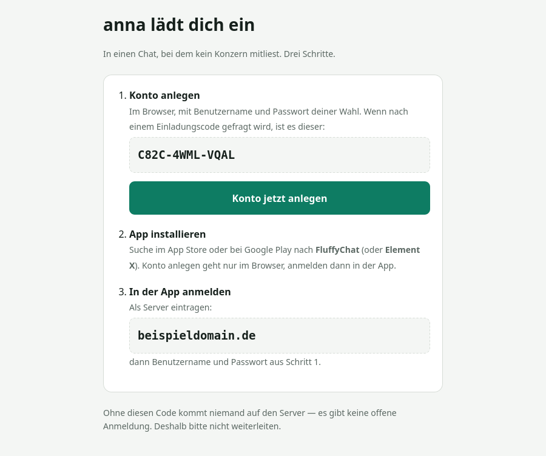
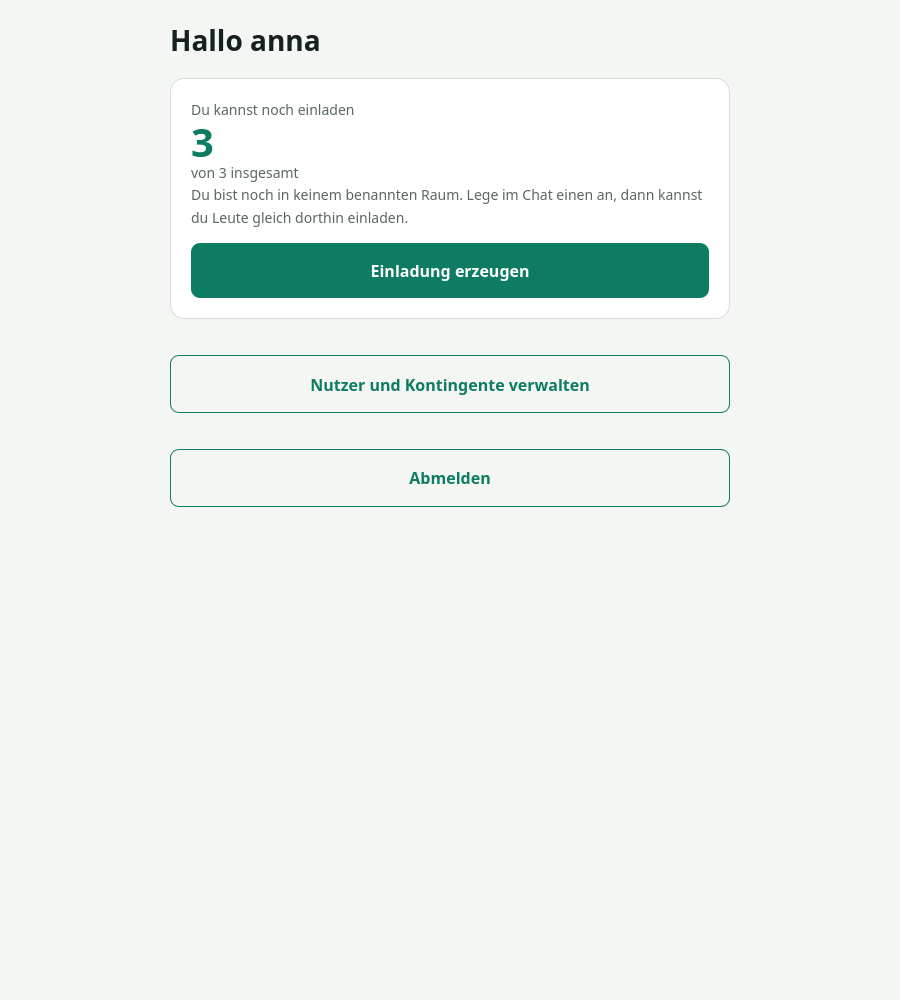
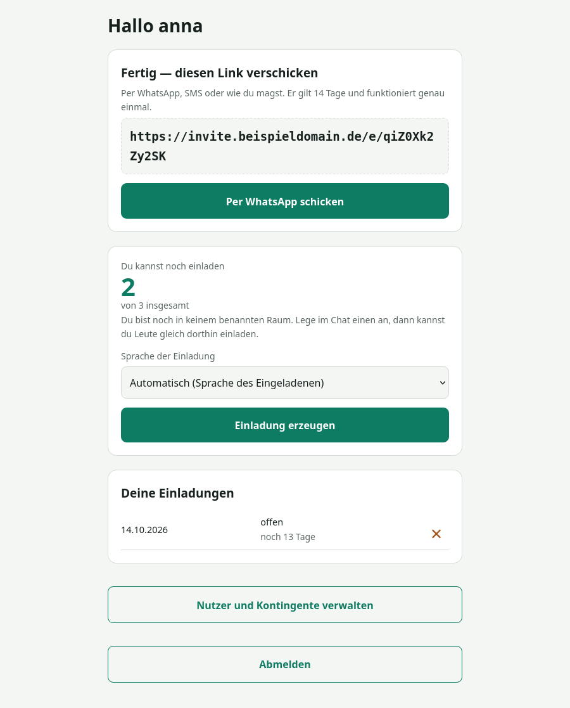
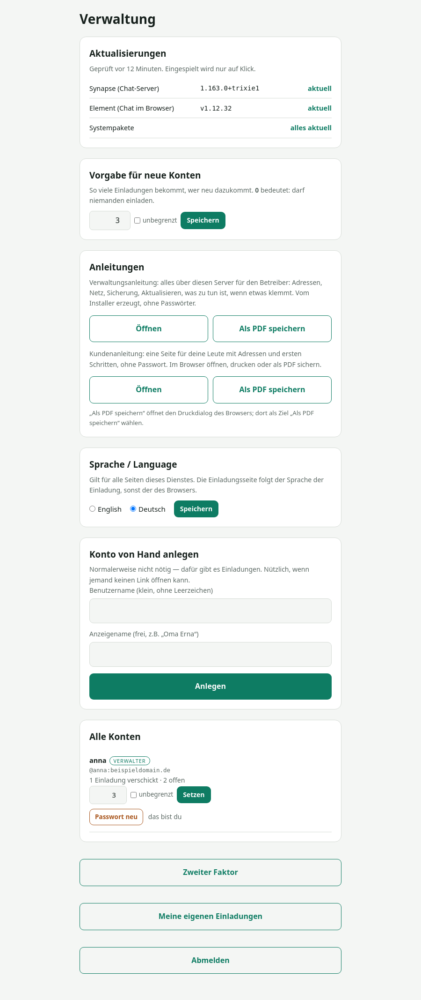
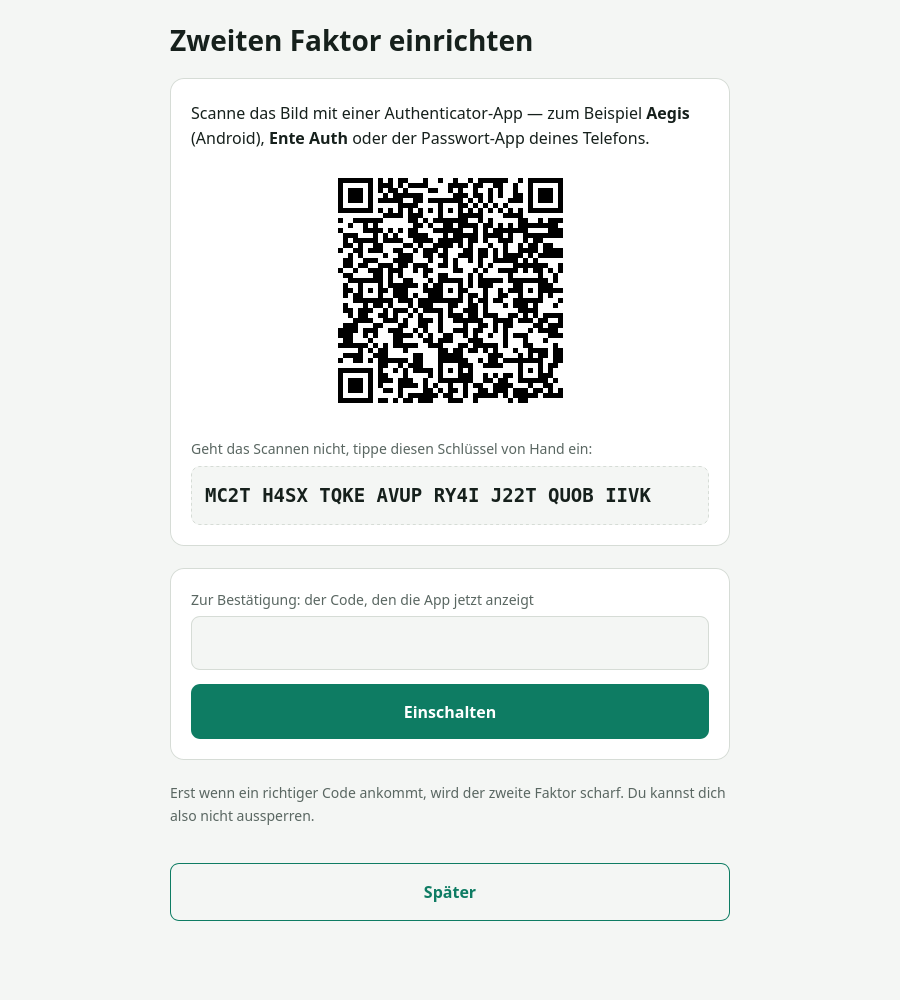

# Ein eigener, verschlüsselter Chat für den eigenen Kreis

Ein Installer, der auf einem frischen Debian-Server in einem Durchgang einen vollständigen,
Ende-zu-Ende-verschlüsselten Chat aufsetzt: Matrix-Server, Verschlüsselung, Anrufe,
Weboberfläche, Verwaltung, Einladungen, Sicherung, Grundhärtung.

```bash
sudo ./install.sh --domain deinedomain.de --mail du@example.de --verwalter dein-name
```

Danach heißen eure Kennungen `@anna:deinedomain.de` und ihr schreibt verschlüsselt miteinander:
Auf dem Server liegt nur Chiffrat, Nachrichteninhalte kann auch der Betreiber nicht lesen.
Wo die Grenzen liegen — Metadaten, Passwörter, der Browser-Client — steht unten unter
**[Was der Betreiber sehen kann](#was-der-betreiber-sehen-kann--und-was-nicht)**.

<p align="center">
  
</p>

---

## Läuft das bei mir?

Kurz vorweg, damit niemand erst nach dem Herunterladen merkt, dass es nicht passt.

| | |
|---|---|
| **Betriebssystem** | Debian 13 (empfohlen) oder Debian 12. **Nichts anderes.** |
| **Architektur** | `amd64` (gewöhnliche PC- und Server-Prozessoren). **Kein ARM.** |
| **Arbeitsspeicher** | 2 GB Minimum, 4 GB für 20–50 Leute, 8 GB mit Reserve |
| **Plattenplatz** | 20 GB Minimum, 80 GB empfohlen — Fotos und Videos wachsen |
| **Eigene Domain** | zwingend, und sie steckt dauerhaft in jeder Kennung |
| **Öffentliche IPv4** | zwingend. Bei DS-Lite-Anschlüssen geht es nicht. |
| **Zugang** | root (oder `sudo`) auf einem Server, der nur dafür da ist |

### Was ausdrücklich NICHT geht

**Raspberry Pi und andere ARM-Rechner.** Das ist keine Faulheit: Die Paketquelle
`packages.matrix.org` führt Synapse ausschließlich für `amd64` und `i386` — für
`arm64` und `armhf` gibt es dort nicht einmal eine Paketliste. Wer Matrix auf einem
Pi betreiben will, braucht Synapse im Container oder aus dem Quelltext; beides kann
dieser Installer nicht, und er tut auch nicht so als ob. Er bricht gleich zu Beginn
mit dieser Begründung ab.

**Windows.** Der Installer ist ein Bash-Skript und baut auf `systemd`, `apt` und
Unix-Dateirechten auf. Auch unter WSL ist das keine sinnvolle Grundlage für einen
Server, der Tag und Nacht erreichbar sein soll.

**Ubuntu — vorerst.** matrix.org liefert durchaus Pakete für Ubuntu (focal, jammy,
noble), und vermutlich liefe es. *Vermutlich* reicht hier aber nicht: Es ist nicht
geprüft worden, also wird es nicht zugesagt. Der Installer weist Ubuntu mit genau
dieser Begründung ab. Wer es ausprobiert hat, möge sich melden — dann steht es
beim nächsten Mal hier als geprüft.

**Ein Server, auf dem schon etwas anderes läuft.** Der Installer will Ports, einen
`nginx` und eine PostgreSQL-Datenbank. Steht dort schon ein Webserver, bricht er ab.
Ausnahme: Läuft bereits ein Reverse-Proxy im Haus, nimm `--hinter-proxy`
(siehe Installation).

### Erfülle ich das?

Diese drei Zeilen auf dem Server beantworten alles:

```bash
. /etc/os-release && echo "$PRETTY_NAME"      # Debian 12 oder 13?
dpkg --print-architecture                      # muss amd64 sagen
free -g; df -h /                               # Speicher und Platz
```

Und der Installer prüft es ohnehin **vor der ersten Änderung** noch einmal selbst —
samt DNS und Ports. Was nicht stimmt, bricht ab, ohne dass etwas angefasst wurde
(einzige Ausnahme: ein fehlendes `curl` wird vorher nachinstalliert, die Prüfung braucht es).

---

## Warum es das gibt

Matrix ist ein ausgezeichnetes Protokoll. Aber einen Matrix-Server aufzusetzen heißt heute:
rund vierzig Schritte aus den Anleitungen von fünf verschiedenen Projekten, und die
Anruf-Konfiguration bekommt man trotzdem falsch hin.

Und selbst wenn er läuft, fehlt das Entscheidende: **Matrix kann keine Einladungen durch
normale Nutzer.** Registrierungs-Token darf nur der Serververwalter erzeugen. Die Mutter kann
also den Vater nicht einladen — alles muss über den Techniker laufen. Genau daran scheitert
ein Familien-Chat im Alltag.

Dieses Projekt schließt beide Lücken.

## Was es ist

- **Ein Befehl** statt vierzig Schritten
- **Einladungen für alle**: Jeder Nutzer bekommt ein Kontingent und verschickt Links
- **Einladungen bringen ihren Raum mit**: Beim Erzeugen wählst du, wohin die Person soll.
  Sie landet direkt dort — statt in einer leeren App — und getrennte Kreise auf demselben
  Server bleiben getrennt
- **Nachvollziehbare Einladungskette**: Zu jedem per Einladung geholten Konto ist sichtbar,
  wer es geholt hat. Ehrlich dazu: Matrix verrät nicht, wer einen Einladungslink benutzt
  hat. Der Dienst ordnet über den Anmeldezeitpunkt zu — und nur, wenn genau ein Konto in
  Frage kommt. Sonst gilt die Einladung als **eingelöst, Zuordnung unklar**: Das
  Kontingent bleibt verbraucht, der Link ist verbrannt, die Verwaltung zeigt sie als
  „unklar“, und der Neue bekommt keine automatische Raumeinladung — ihn lädt man im
  Chat von Hand ein. Die Zuordnung wird bei jedem Durchlauf erneut versucht; sie gelingt
  später, wenn die anderen Kandidaten inzwischen zugeordnet sind — kommen aber zwei
  Neulinge in derselben Minute über zwei Einladungen herein, bleibt es dauerhaft bei
  „unklar“. Das ist so gewollt: lieber eine ehrliche Lücke als ein falscher Eintrag. Von Hand angelegte Konten und das Verwalterkonto haben keinen
  Ketteneintrag. Und: **Abmelden** auf der Einladungsseite beendet alle Sitzungen
  dieses Kontos dort, auch auf anderen Geräten
- **Zurückziehen**: Eine offene Einladung lässt sich mit dem ✕ an ihrer Zeile zurückziehen —
  der Code wird beim Server gelöscht, der Link meldet „zurückgezogen“, das Kontingent ist
  wieder frei. Für die doppelt verschickte Einladung, nicht für die eingelöste.
- **Vernünftige Voreinstellungen**: Verschlüsselung an, Registrierung nur per Einladung,
  keine Vorschauen von fremden Seiten, zwischengespeicherte Medien fremder Server
  werden nach 90 Tagen geräumt
- **Deutsche Oberfläche und Dokumentation** — für Leute, die kein Englisch lesen wollen
- **Eine fertige Kundenanleitung**, bei der Installation mit den echten Zugangsdaten befüllt

## Was es nicht ist

Damit niemand enttäuscht wird:

- **Kein WhatsApp-Ersatz.** Eure Leute müssen aktiv wechseln. Das klappt nur im eigenen Kreis.
- **Kein Mehrmandanten-Betrieb.** Ein Server, eine Gemeinschaft.
- **Keine neue Verschlüsselung.** Das macht alles Matrix; hier wird nichts selbst gebastelt.
- **Keine eigene App.** Ihr nutzt fertige aus den Stores — und das ist Absicht:
  So hat nicht derselbe die App gebaut, der auch den Server betreibt.
- **Kein Produkt mit Rund-um-die-Uhr-Betreuung.** Ein gepflegtes Nebenprojekt.

## Voraussetzungen

Die Eckdaten stehen oben unter **[Läuft das bei mir?](#läuft-das-bei-mir)**. Hier noch:

| | |
|---|---|
| Server | Debian 13 (oder 12), amd64, **4 Kerne, 8 GB RAM, 80 GB** für 20–50 Leute |
| Domain | eine eigene — sie steckt dauerhaft in jeder Kennung |
| DNS | sechs A-Einträge (siehe unten) |
| Zuhause? | Geht — aber viele Anschlüsse haben keine eigene öffentliche IPv4 (DS-Lite). Dann klappt es nicht. Der Installer sagt es dir. |
| Schon ein Proxy da? | Dann `--hinter-proxy` benutzen (siehe Installation). |

**Die Domain lässt sich später nicht ändern**, ohne alle Konten neu anzulegen. Vorher überlegen.

### DNS

```
deinedomain.de              A   <IP>
matrix.deinedomain.de       A   <IP>
chat.deinedomain.de         A   <IP>
einladung.deinedomain.de    A   <IP>
verwaltung.deinedomain.de   A   <IP>
turn.deinedomain.de         A   <IP>
```

## Installation

Auf dem frischen Server fehlt `git`. Deshalb holst du das Repository auf deinem
Rechner und kopierst es per `scp` hinüber:

```bash
git clone https://github.com/Gekons/Humatrix.git     # auf deinem Rechner
scp -r Humatrix root@<IP>:/root/
ssh root@<IP>                                         # ab hier auf dem Server
cd /root/Humatrix
./install.sh --domain deinedomain.de --mail du@example.de --verwalter dein-name
```

Mit Sicherung auf einen entfernten Speicher:

```bash
sudo ./install.sh --domain deinedomain.de --mail du@example.de --verwalter dein-name \
                  --sicherung user@storage.example.de:/messenger
```

Der Schlüssel der verschlüsselten Sicherung liegt danach in `/root/.sicherung_passwort`.
**Ohne ihn ist keine Sicherung wiederherstellbar** — ins Passwortdepot damit.

Der Installer prüft **vor der ersten Änderung** System, Arbeitsspeicher, Plattenplatz, alle
sechs DNS-Namen und die Ports — und bricht ab, ohne etwas angefasst zu haben, wenn etwas
fehlt (einzige Ausnahme: ein fehlendes `curl` wird vorher nachinstalliert, die Prüfung
braucht es). Am Ende laufen zehn Nachkontrollen, mit `--sicherung` elf.

Einzelnen Abschnitt wiederholen: `--nur turn` (siehe `--hilfe`). Mit
`--betreiber "Name, mail@example.de"` stehen Name und Erreichbarkeit des Betreuers in
der Kundenanleitung und in den Hinweisen des Einladungsdienstes — sonst steht dort nur
„dein Betreuer".

### Schon ein Reverse-Proxy im Haus?

Wer zuhause bereits einen Nginx Proxy Manager, Traefik oder Caddy betreibt, dem
gehören die Ports 80 und 443 der öffentlichen Adresse bereits. Dann:

```bash
sudo ./install.sh --domain deinedomain.de --verwalter dein-name --hinter-proxy
```

In diesem Modus holt der Installer **kein** Zertifikat und liefert alles als
Klartext auf Port 80 aus — um TLS kümmert sich der vorhandene Proxy. Am Ende
sagt er dir, welche fünf Einträge du dort anlegen musst. Die DNS-Namen dürfen
dann auf den Proxy zeigen statt auf diesen Server; der Installer akzeptiert das
und meldet es nur.

Einschränkung: Verschlüsseltes TURN (Port 5349) gibt es so nicht, weil kein
Zertifikat auf dem Rechner liegt. TURN läuft unverschlüsselt auf 3478 — kein
Schaden, denn die Gesprächsinhalte sind ohnehin Ende zu Ende verschlüsselt,
TURN leitet nur weiter.

## Was danach läuft

| Adresse | für wen |
|---|---|
| `https://chat.deinedomain.de` | alle — Chat im Browser |
| `https://einladung.deinedomain.de` | alle — Einladungen verschicken |
| `https://verwaltung.deinedomain.de` | nur Verwalter — Konten und Kontingente |
| Handy-App | FluffyChat oder Element X, als Server `deinedomain.de` eintragen |

### Einladen kann jeder — so viel, wie du erlaubst

<p align="center">
  
  
</p>

Ein Knopfdruck, ein Link, fertig. Die Einladung gilt 14 Tage und funktioniert genau einmal.
Der Code ist bewusst ohne verwechselbare Zeichen: `Y9RV-3GZW-JJ57`.

### Verwaltung

<p align="center">
  
</p>

Kontingent je Person frei eintragbar — **0** heißt „darf niemanden einladen", dazu ein Haken
für unbegrenzt. Konten anlegen, sperren, Passwörter zurücksetzen, Verwalter ernennen.
Und: **wer hat wen geholt** — soweit die Zuordnung eindeutig war (siehe oben).

Verwalter ist, wer es am Matrix-Server ist — keine zweite Rechteverwaltung, kein zweites Passwort.

### Zweiter Faktor

<p align="center">
  
</p>

TOTP, zweistufige Anmeldung, Geheimnis verschlüsselt in der Ablage, Drossel nach fünf
Fehlversuchen. Scharf wird es erst nach einem gültigen Code — aussperren kann man sich
beim Einrichten nicht.

Telefon verloren? `python3 /opt/einladung/einladung.py --zweitfaktor-aus <name>` als root.

## Die Entscheidungen, die der Installer für dich trifft

| | warum |
|---|---|
| Registrierung **nur per Einladung** | Jedes Konto braucht eine Einladung, und die Kette dahinter ist nachvollziehbar, soweit sich die Zuordnung eindeutig treffen ließ (siehe oben). Das ist die Missbrauchsbremse — nicht die Verschlüsselung. |
| Suche nur **innerhalb geteilter Räume** | Mehrere Kreise auf einem Server (Familie, Verein, Freundeskreis) sehen einander nicht. Umstellbar, wenn es nur einen Kreis gibt — in `/etc/matrix-synapse/conf.d/50-eigene.yaml` (nicht in `20-betrieb.yaml`, die schreibt der Installer bei jedem Lauf neu): `user_directory: {enabled: true, search_all_users: true, prefer_local_users: true}`, dann `systemctl restart matrix-synapse`. Siehe [docs/betreiber.md](docs/betreiber.md). |
| Föderation **offen** | Eure Leute erreichen das weltweite Matrix-Netz. Bringt **keine** fremden Konten auf euren Server. |
| Verschlüsselung **überall** voreingestellt | Nicht als Sonderfall, sondern als Normalfall. |
| Vorschaubilder **aus** | Sonst ruft euer Server fremde Seiten ab und verrät, was jemand verlinkt hat. |
| Nur **Sicherheits**updates automatisch | Alles andere bewusst von Hand. |
| Fremde Medien nach **90 Tagen** geräumt | Betrifft nur den Zwischenspeicher für Medien anderer Server. Eure eigenen Fotos und Videos bleiben dauerhaft — bei Ende-zu-Ende-Verschlüsselung wäre Löschen Datenverlust. Deshalb 80 GB einplanen und `du -sh /var/lib/matrix-synapse/media` im Blick behalten (siehe [docs/betreiber.md](docs/betreiber.md)). |

## Was der Betreiber sehen kann — und was nicht

Das gehört offen auf den Tisch, und es ist überprüfbar:

| | |
|---|---|
| Nachrichten, Fotos, Dateien | **nein** — auf dem Server liegt nur Chiffrat |
| Wer wann mit wem | **ja** (Metadaten) |
| Verlauf wiederherstellen | **nein** — die Schlüssel liegen auf den Geräten |
| Passwörter neu setzen | **ja** — damit ließe sich ein Konto übernehmen und ab dann mitlesen; alte Nachrichten bleiben ihm verschlossen, und die Geräteprüfung in der App macht so einen Versuch sichtbar (siehe [SECURITY.md](SECURITY.md)) |
| Weboberfläche im Browser | der Betreiber liefert den Client-Code selbst aus (`/var/www/element`) und könnte ihn verändern — die Verschlüsselung schützt im Browser also nicht gegen ihn. Wer das ausschließen will, nimmt die Handy-App aus dem Store |

Nachprüfen: `su - postgres -c "psql synapse"` und in die Ereignistabelle schauen.
Da steht Buchstabensalat.

## Betrieb

| Was | Wie oft |
|---|---|
| Sicherheitsupdates | automatisch |
| Synapse aktualisieren | bewusst: `apt update && apt install matrix-synapse-py3` |
| Element Web aktualisieren | bewusst, z. B. monatlich: `./install.sh --domain … --mail … --nur element` — holt nur, wenn eine neuere Fassung vorliegt. Der Browser-Client bekommt keine Debian-Sicherheitsupdates |
| Sicherung prüfen | monatlich |
| **Wiederherstellung üben** | **jährlich** — eine Sicherung, die nie zurückgespielt wurde, ist keine |
| Zertifikate | automatisch (certbot; coturn bekommt seine Kopien über einen Haken) |

Ausführlich: **[docs/betreiber.md](docs/betreiber.md)**

## Die Anleitung, die deine Leute bekommen

Der Installer erzeugt am Ende eine fertige Anleitung — befüllt mit der echten
Adresse, dem echten Kontonamen und dem Startpasswort, mit Bildern, zum
Ausdrucken oder als PDF weitergeben. So sieht sie aus (mit Platzhaltern):

**[docs/muster-kundenanleitung.html](docs/muster-kundenanleitung.html)**

## Getestet

Funktionstest 18 von 18, Lasttest mit 50 Konten und 15 gleichzeitig Schreibenden,
Installationstest auf frischem Debian 13. Mit vollständiger Fehlerliste — auch den
sieben Fehlern, die der Installationstest selbst zutage gefördert hat, und den
Grenzen dessen, was die Tests belegen.

**[docs/testbericht.md](docs/testbericht.md)**

| | |
|---|---|
| 150 Nachrichten von 15 Leuten gleichzeitig | 7,8 s, Mitte 108 ms |
| Verschlüsselter Raum mit 50 Mitgliedern | Schlüssel an alle in 0,51 s |
| Arbeitsspeicher unter Last (von 4 GB) | 366 MB |

## Mitmachen

Fehlerberichte und Verbesserungen sind willkommen — siehe [CONTRIBUTING.md](CONTRIBUTING.md).
Sicherheitslücken **nicht** als öffentliches Ticket, sondern wie in [SECURITY.md](SECURITY.md)
beschrieben.

Wenn dir das Projekt etwas wert ist: Spenden halten es am Leben und die Entwicklung unabhängig.

## Was hier drinsteckt — und von wem

Der weitaus größte Teil dessen, was nach der Installation läuft, stammt **nicht aus diesem
Projekt**. Das gehört gesagt:

| Bestandteil | von | Lizenz |
|---|---|---|
| **Matrix** — das Protokoll | [The Matrix.org Foundation](https://matrix.org) | Apache-2.0 |
| **Synapse** — der Server, inklusive der Verschlüsselung | [Element](https://github.com/element-hq/synapse) | AGPL-3.0 |
| **Element Web** — der Browser-Client | [Element](https://github.com/element-hq/element-web) | AGPL-3.0 |
| **coturn** — Sprach- und Videoanrufe | [coturn-Projekt](https://github.com/coturn/coturn) | BSD |
| **FluffyChat, Element X** — die Handy-Apps | jeweilige Projekte | AGPL-3.0 |
| **pyotp, qrcode, cryptography** — zweiter Faktor der Einladungsseite und Verschlüsselung der TOTP-Geheimnisse, als Debian-Pakete | [pyotp](https://github.com/pyotp/pyotp), [python-qrcode](https://github.com/lincolnloop/python-qrcode), [pyca/cryptography](https://cryptography.io) | MIT, BSD, Apache-2.0/BSD |
| PostgreSQL, nginx, certbot, Debian | jeweilige Projekte | — |

**Was dieses Projekt beisteuert:**

1. **Den Installer** — ein Befehl statt vierzig Schritten, mit Vorabprüfung und Nachkontrolle
2. **Die Einladungsseite** — Kontingente je Nutzer, nachvollziehbare Kette, Raumzuordnung,
   zweiter Faktor. Das ist die einzige wirklich neue Software hier; Matrix hat keinen
   Mechanismus, mit dem ein **normaler Nutzer** jemanden einladen kann.
3. **Die Voreinstellungen** — jede einzeln trivial, zusammen der Unterschied zwischen
   „läuft für eine Familie" und „Bastelprojekt eines Administrators"
4. **Deutschsprachige Dokumentation**

Synapse und die anderen Bestandteile werden hier **nicht mitgeliefert**, sondern bei der
Installation aus ihren offiziellen Quellen geholt. Dieses Projekt ist nicht mit der
Matrix.org-Stiftung oder Element verbunden und wird von ihnen nicht unterstützt.

Wenn dir das Ergebnis gefällt: Der Dank gehört zuerst den Projekten in der Tabelle oben.
Spenden an [matrix.org](https://matrix.org/donate/) kommen der Grundlage zugute, auf der
hier alles steht.

## Lizenz

[AGPL-3.0](LICENSE). Wer diese Software betreibt und verändert, gibt die Änderungen weiter.
Das ist der Punkt: Ein Werkzeug für Datenhoheit soll nicht in einem geschlossenen Dienst
verschwinden.
