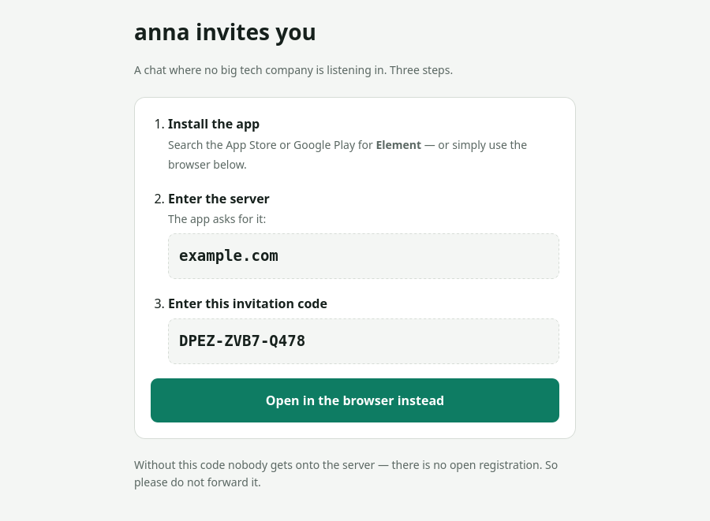
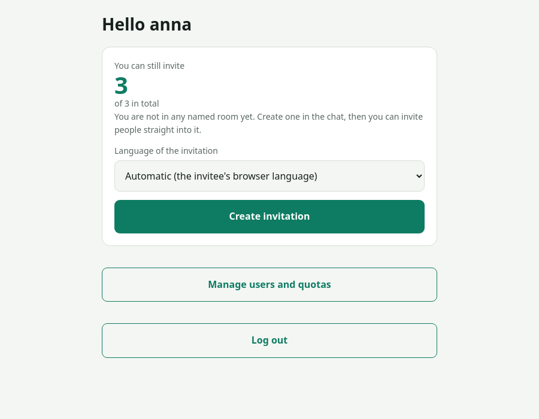
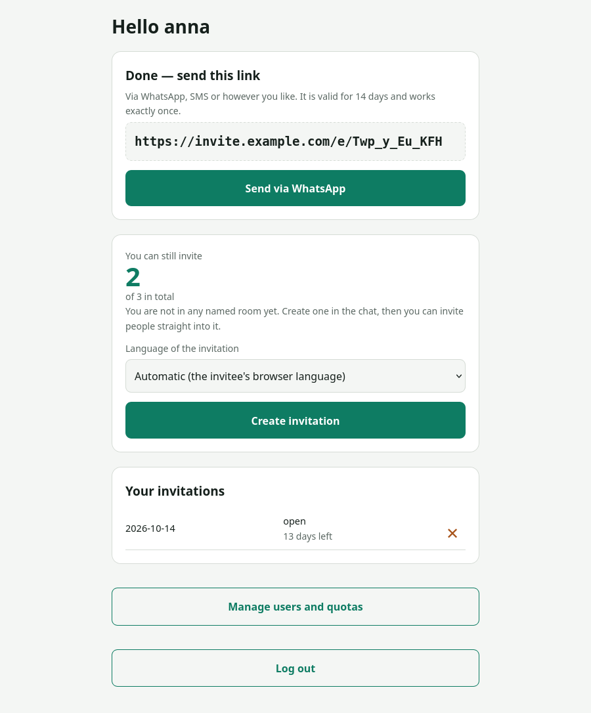
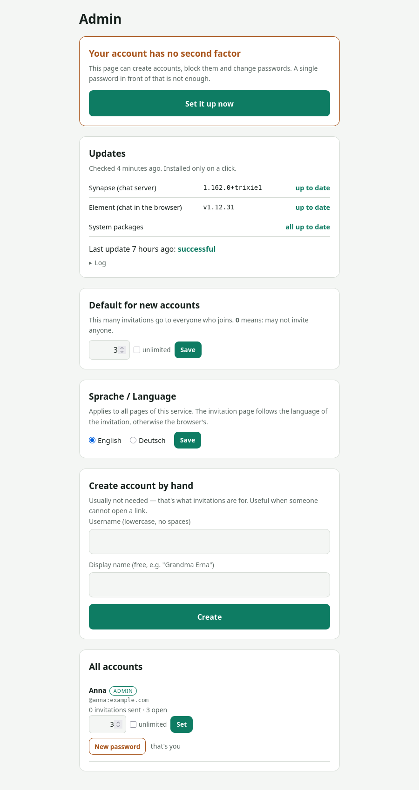

**English** | [Deutsch](README.de.md)

# Humatrix

A Matrix server for your family, club or circle of friends, set up in one run on a
fresh Debian box. The installer puts Synapse, Element Web, coturn, nginx and a backup
in place, and adds an invitation page so that normal users can bring people in
without going through the admin.

```bash
sudo ./install.sh --domain example.com --mail you@example.com --admin your-name
```

Afterwards your IDs look like `@anna:example.com`. Messages are end-to-end
encrypted, so the server only ever holds ciphertext. What the operator can and cannot
see is listed under [What the operator can see](#what-the-operator-can-see).

<p align="center">
  
</p>

---

## Will it run for me?

| | |
|---|---|
| **Operating system** | Debian 13 (recommended) or Debian 12. Nothing else. |
| **Architecture** | `amd64`. No ARM. |
| **Memory** | 2 GB minimum, 4 GB for 20–50 people, 8 GB with headroom |
| **Disk space** | 20 GB minimum, 80 GB recommended; photos and videos add up |
| **Your own domain** | required; it becomes part of every user ID and cannot be changed later |
| **Public IPv4** | required; does not work on DS-Lite connections |
| **Access** | root (or `sudo`) on a server that does nothing else |

### What does not work

**Raspberry Pi and other ARM machines.** `packages.matrix.org` ships Synapse for
`amd64` and `i386` only. Running Matrix on a Pi means Synapse in a container or built
from source, and this installer does neither. It aborts at the start with that reason.

**Windows.** The installer is a Bash script and relies on `systemd`, `apt` and Unix
file permissions. WSL is not a sensible basis for a server that has to be up all day.

**Ubuntu, for now.** matrix.org does ship packages for Ubuntu (focal, jammy, noble) and
it would probably work, but it has not been tested, so the installer rejects it. If you
have tried it, open an issue and it will be listed as tested.

**A server that already runs something else.** The installer needs the web ports, an
`nginx` and a PostgreSQL database for itself. If a web server is already there, it
aborts. If what is there is a reverse proxy, use `--behind-proxy` (see Installation).

### Do I meet this?

```bash
. /etc/os-release && echo "$PRETTY_NAME"      # Debian 12 or 13?
dpkg --print-architecture                      # must say amd64
free -g; df -h /                               # memory and disk space
```

The installer checks all of this again before its first change, including DNS and
ports, and aborts without touching anything if something is missing. The one
exception: a missing `curl` is installed first, because the check needs it.

---

## Why this exists

Setting up a Matrix server by hand means following the manuals of five projects and
getting the call configuration wrong at least once.

Once it runs, something is still missing: Matrix has no invitations by normal users.
Only the server admin can create registration tokens, so every new family member has
to go through the one person who knows the server. Humatrix adds that missing piece.

## What it is

- **One command** for the whole setup, re-runnable at any time
- **Invitations for everyone**: each user gets a quota and sends out links
- **Invitations carry a room**: when you create one, you pick the room the person
  should land in. Separate circles on the same server stay separate.
- **Traceable invitation chain**: for every account that came in by invitation, the
  admin page shows who brought it in. Matrix itself does not reveal who used a link, so
  the service matches by sign-up time, and only when exactly one account is a
  candidate. Otherwise the invitation is marked **redeemed, assignment unclear**: the
  quota stays used, the link is burnt, and the newcomer gets no automatic room
  invitation, you invite them by hand in the chat. Matching is retried on every run
  and may succeed later once the other candidates are assigned. Two newcomers in the
  same minute through two links stay unclear for good; a gap is preferred over a wrong
  entry. Accounts created by hand and the admin account have no chain entry.
- **Revoking**: an open invitation can be revoked with the ✕ on its row. The code is
  deleted at the server, the link reports "revoked", the quota is free again.
- **Log out** on the invitation page ends all sessions of that account there, on
  other devices too.
- **Sensible defaults**: encryption on, registration by invitation only, no link
  previews, cached media from other servers cleared after 90 days
- **English and German**: `--language en|de` for the installer (default `en`), a
  language card in the admin page, and each invitation can carry its own language;
  without one, the invitation page follows the visitor's browser. Documentation and the
  customer guide exist in both languages.
- **A customer guide**, generated at the end of the installation with the real
  address, account name and initial password

## What it is not

- **Not a WhatsApp replacement.** Your people have to switch on purpose. That works
  within a circle, not for everyone.
- **No multi-tenant operation.** One server, one community.
- **No new encryption.** Matrix does all of that. Nothing cryptographic is written here.
- **No app of its own.** You use the ones from the stores. That also means the person
  who wrote the app is not the person who runs the server.
- **Not a product with round-the-clock support.** A maintained side project.

## Requirements

Key figures are above under [Will it run for me?](#will-it-run-for-me). In addition:

| | |
|---|---|
| Server | Debian 13 (or 12), amd64, **4 cores, 8 GB RAM, 80 GB** for 20–50 people |
| Domain | your own; it becomes part of every user ID |
| DNS | six A records (see below) |
| At home? | Works, but many connections have no public IPv4 of their own (DS-Lite). The installer tells you. |
| Already have a proxy? | Use `--behind-proxy` (see Installation). |

The domain cannot be changed later without recreating all accounts.

### DNS

```
example.com              A   <IP>
matrix.example.com       A   <IP>
chat.example.com         A   <IP>
invite.example.com       A   <IP>
service.example.com      A   <IP>
turn.example.com         A   <IP>
```

## Installation

A fresh server has no `git`, so clone on your own machine and copy the folder over:

```bash
git clone https://github.com/Gekons/Humatrix.git     # on your machine
scp -r Humatrix root@<IP>:/root/
ssh root@<IP>                                         # from here on: on the server
cd /root/Humatrix
./install.sh --domain example.com --mail you@example.com --admin your-name
```

With backup to remote storage:

```bash
sudo ./install.sh --domain example.com --mail you@example.com --admin your-name \
                  --backup user@storage.example.com:/messenger
```

The key of the encrypted backup is then in `/root/.sicherung_passwort`. Without it no
backup can be restored, so put it in your password manager.

Before the first change the installer checks the system, memory, disk space, all six
DNS names and the ports, and aborts without having touched anything if something is
missing. At the end ten checks run, eleven with `--backup`.

Switches:

- `--only <section>` repeats a single section, e.g. `--only turn` (see `--help`).
- `--operator "Name, mail@example.com"` puts the name and contact of the person looking
  after the server into the customer guide and the notes of the invitation service.
  Without it the texts say "your contact person" / "the operator".
- `--language en|de` sets the language of the installer output, the web pages and the
  customer guide. Default is English. The admin page can switch the web pages later.
  A repeat run keeps the language of the existing installation unless `--language` is
  given again.
- Every switch also has a German spelling (`--verwalter`, `--sicherung`, `--betreiber`,
  `--nur`, `--hinter-proxy`). Section names and host name prefixes (`matrix.`, `chat.`,
  `invite.`, `service.`, `turn.`) are the same in both languages.

### Already have a reverse proxy?

If a Nginx Proxy Manager, Traefik or Caddy already owns ports 80 and 443 of your public
address:

```bash
sudo ./install.sh --domain example.com --admin your-name --behind-proxy
```

In this mode the installer fetches no certificate and serves everything as plain HTTP
on port 80; the proxy does TLS. At the end it lists the five entries to create on the
proxy. The DNS names may point to the proxy instead of this server; the installer
accepts that and only reports it.

Limitation: TURN over TLS (port 5349) is not available this way, because there is no
certificate on the machine. TURN runs on 3478. Call content is end-to-end encrypted
anyway; TURN only relays packets.

## What runs afterwards

| Address | for whom |
|---|---|
| `https://chat.example.com` | everyone: chat in the browser |
| `https://invite.example.com` | everyone: send invitations |
| `https://service.example.com` | admins only: accounts and quotas |
| Phone app | FluffyChat or Element X, enter `example.com` as the server |

### Inviting

<p align="center">
  
  
</p>

One click produces a link. It is valid for 14 days and works once. The code avoids
easily confused characters: `Y9RV-3GZW-JJ57`.

### Administration

<p align="center">
  
</p>

Quota per person, **0** meaning "may not invite anyone", plus a checkbox for unlimited.
Create accounts, suspend them, reset passwords, appoint admins. And "who brought in
whom", as far as the assignment was unambiguous (see above).

The top of the page shows whether updates are pending (Synapse, Element Web, system
packages; checked daily). Nothing is installed on its own: a button, then a
confirmation that says what will happen and that the chat pauses briefly.

An admin is whoever is an admin on the Matrix server. There is no second permission
system and no second password.

### Second factor

<p align="center">
  
</p>

TOTP, two-step login, secret stored encrypted, throttling after five failed attempts.
It only becomes active after a valid code, so you cannot lock yourself out while
setting it up.

Lost your phone? As root: `python3 /opt/einladung/einladung.py --zweitfaktor-aus <name>`

## The defaults

| | why |
|---|---|
| Registration **by invitation only** | Every account needs an invitation, and the chain behind it is traceable as far as the assignment was unambiguous. This, not the encryption, is what limits abuse. |
| Search only **within shared rooms** | Several circles on one server (family, club, friends) do not see each other. With only one circle you can change it in `/etc/matrix-synapse/conf.d/50-eigene.yaml` (not in `20-betrieb.yaml`, which the installer rewrites): `user_directory: {enabled: true, search_all_users: true, prefer_local_users: true}`, then `systemctl restart matrix-synapse`. See [docs/operator.md](docs/operator.md). |
| Federation **open** | Your people can reach the whole Matrix network. This brings no outside accounts onto your server. |
| Encryption **on** for new rooms | The normal case, not a special case. |
| Link previews **off** | Otherwise the server fetches external pages and reveals what someone linked. |
| Only **security** updates automatic | Everything else is checked daily and installed on a click in the admin page. |
| Media from other servers cleared after **90 days** | Only the cache for remote media. Your own photos and videos stay; with end-to-end encryption, deleting would mean losing them. Plan for 80 GB and watch `du -sh /var/lib/matrix-synapse/media` (see [docs/operator.md](docs/operator.md)). |

## What the operator can see

| | |
|---|---|
| Messages, photos, files | **no**; the server holds only ciphertext |
| Who, when, with whom | **yes** (metadata) |
| Restore history | **no**; the keys are on the devices |
| Reset passwords | **yes**. That would allow taking over an account and reading along from then on. Old messages stay locked, and the device verification in the app makes such an attempt visible (see [SECURITY.md](SECURITY.md)). |
| Web client in the browser | The operator serves the client code (`/var/www/element`) and could alter it, so in the browser the encryption does not protect against the operator. If that matters to you, use the phone app from the store. |

To verify: `su - postgres -c "psql synapse"` and look at the events table.

## Operation

| What | How often |
|---|---|
| Security updates | automatic |
| Everything else (system packages, Synapse, Element Web) | checked daily, shown in the admin page, installed on a click after confirmation. Synapse restarts, the chat is briefly unreachable. |
| Synapse by hand | `apt update && apt install matrix-synapse-py3`, or as root `messenger-update-ausfuehren.sh`, which installs everything the check reported |
| Element Web by hand | `./install.sh --domain … --mail … --only element`; fetches only if a newer version exists. The browser client gets no Debian security updates. |
| Check backup | monthly |
| Practice a restore | yearly. A backup that has never been restored is not a backup. |
| Certificates | automatic (certbot; coturn gets its copies via a hook) |

Details: [docs/operator.md](docs/operator.md)

### Embedding the chat in Nextcloud

If your circle already uses a Nextcloud, the chat can appear there as an app: install
the **External sites** app, add a site with the URL `https://chat.<domain>/`, leave
"Redirect" off (embedded) and upload a 32×32 PNG with transparency as the icon. The
chat host sends no `X-Frame-Options` or `frame-ancestors` restriction, so this works
without further changes. The invitation page (`invite.<domain>`) is not meant for
embedding; people open it from the link they received.

## The guide your people get

At the end the installer writes a guide with the real address, the account name and
the initial password, with pictures, in the language chosen with `--language`. Print it
or pass it on as a PDF. Samples with placeholders:

**[docs/sample-customer-guide.html](docs/sample-customer-guide.html)** (English) ·
**[docs/muster-kundenanleitung.html](docs/muster-kundenanleitung.html)** (German)

## Tested

Function test 18 of 18, load test with 50 accounts and 15 writing at the same time,
installation test on a fresh Debian 13. The report lists every defect found, including
the seven the installation test itself turned up, and what the tests do not prove.

[docs/test-report.md](docs/test-report.md)

| | |
|---|---|
| 150 messages from 15 people at the same time | 7.8 s, median 108 ms |
| Encrypted room with 50 members | keys to everyone in 0.51 s |
| Memory under load (of 4 GB) | 366 MB |

## Contributing

Bug reports and improvements are welcome, see [CONTRIBUTING.md](CONTRIBUTING.md).
Security issues not as a public ticket; see [SECURITY.md](SECURITY.md).

## What's inside, and from whom

Most of what runs after the installation does not come from this project:

| Component | from | License |
|---|---|---|
| **Matrix**, the protocol | [The Matrix.org Foundation](https://matrix.org) | Apache-2.0 |
| **Synapse**, the server, including the encryption | [Element](https://github.com/element-hq/synapse) | AGPL-3.0 |
| **Element Web**, the browser client | [Element](https://github.com/element-hq/element-web) | AGPL-3.0 |
| **coturn**, voice and video calls | [coturn project](https://github.com/coturn/coturn) | BSD |
| **FluffyChat, Element X**, the phone apps | respective projects | AGPL-3.0 |
| **pyotp, qrcode, cryptography**, second factor of the invitation page and encryption of the TOTP secrets, as Debian packages | [pyotp](https://github.com/pyotp/pyotp), [python-qrcode](https://github.com/lincolnloop/python-qrcode), [pyca/cryptography](https://cryptography.io) | MIT, BSD, Apache-2.0/BSD |
| PostgreSQL, nginx, certbot, Debian | respective projects | — |

What this project adds:

1. **The installer**, with pre-checks and final checks
2. **The invitation page**: quotas per user, traceable chain, room assignment, second
   factor. This is the only new software here; Matrix has no way for a normal user to
   invite someone.
3. **The defaults**, each small on its own
4. **Interface and documentation in English and German**

Synapse and the other components are not shipped here; they are fetched from their
official sources during installation. This project is not affiliated with the
Matrix.org Foundation or Element and is not endorsed by them. If you want to donate,
[matrix.org](https://matrix.org/donate/) is the foundation everything here stands on.

## Tip jar

Humatrix is a side project with no company behind it. If it is useful to you:
[ko-fi.com/humatrix](https://ko-fi.com/humatrix). Nothing is required, and nothing
changes if you don't.

## License

[AGPL-3.0](LICENSE). Whoever runs a modified version has to pass the changes on.
