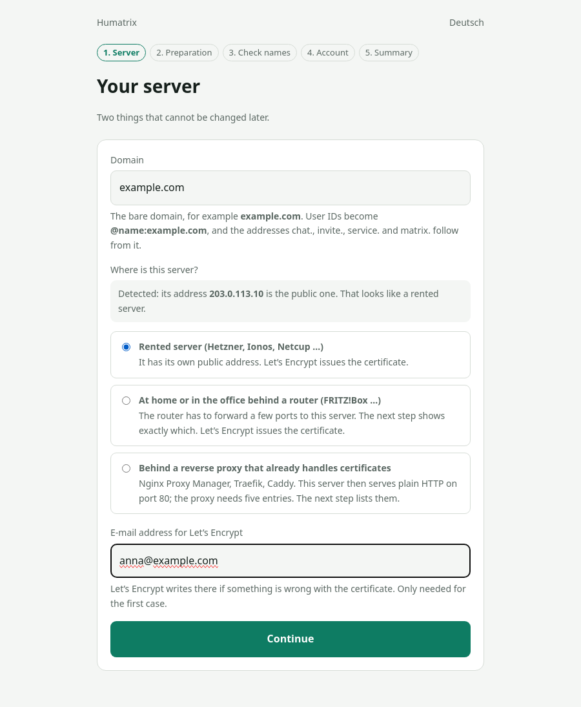
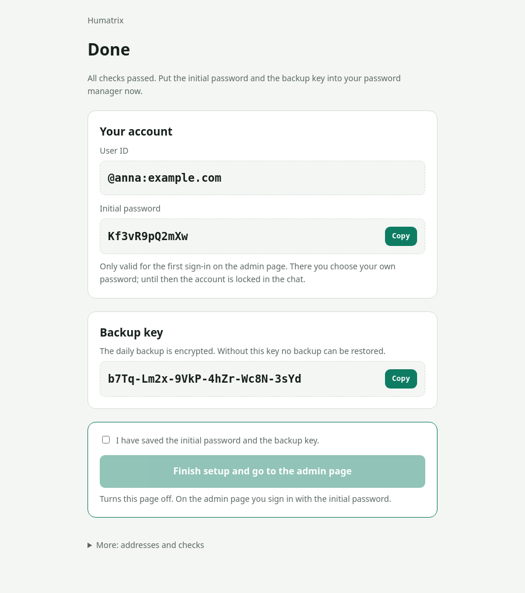
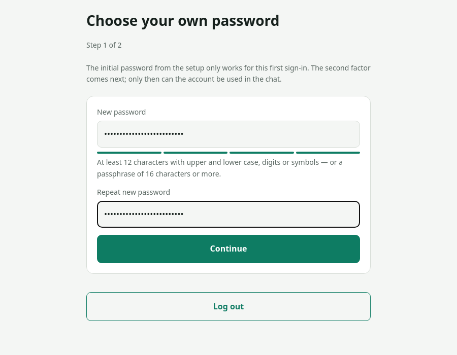

**English** | [Deutsch](betreiber.md)

# Operator guide: setting up a customer server

From ordering to handover. Allow 30 minutes, about 10 of them waiting.

---

## Up front: one server per customer

This installer builds a separate server for each customer. Every family gets its own
machine, its own domain and its own data, and can move out at any time.

The numbers for a dedicated server:

| Item | per customer |
|---|---|
| Hetzner Cloud CX32 (4 cores, 8 GB, 80 GB) | ~8 €/month |
| Domain | ~1 €/month |
| **Your costs** | **~9 €/month** |
| Sensible price | **15–19 €/month** |

The margin is thinner than with a shared server, but liability stays separated and
the "you can leave any time" promise holds. With many small customers a multi-tenant
setup pays off; that needs a different installer.

Your real cost is support time, not hardware.

---

## Step 1: Domain

The customer chooses the name. It becomes part of every user ID
(`@anna:familie-mueller.de`) and cannot be changed later without recreating all
accounts. Tell the customer beforehand.

Who buys the domain is a question of trust. My advice: the customer buys it. Then it
belongs to them and they can really move at any time. You only need access to the DNS
records.

## Step 2: Order the server

At Hetzner Cloud:

| | |
|---|---|
| Location | Falkenstein or Nuremberg |
| Image | **Debian 13** |
| Type | **CX32** (4 cores, 8 GB, 80 GB) |
| SSH key | add yours; no password login |
| Network | IPv4 + IPv6 |

Not smaller than 8 GB. Synapse grows with the rooms, and resizing in production is
more work than ordering the right size.

## Step 3: Set DNS

Six A records pointing to the IP of the new server:

```
<domain>              A   <IP>
matrix.<domain>       A   <IP>
chat.<domain>         A   <IP>
invite.<domain>       A   <IP>
service.<domain>      A   <IP>
turn.<domain>         A   <IP>
```

Then wait until they are visible, usually one to ten minutes. Check with:

```bash
for n in "" matrix. chat. invite. service. turn.; do
  echo "$n<domain> -> $(dig +short @1.1.1.1 $n<domain> A)"
done
```

The installer checks this too and aborts if something is missing.

## Step 4: Upload and start the installer

Two ways. The short one is the setup page: on the server run

```bash
curl -fsSLo setup.sh https://raw.githubusercontent.com/Gekons/Humatrix/main/setup.sh
sudo bash setup.sh
```

and open the printed address with the one-time code in a browser. The page asks for
domain, proxy or not, e-mail, the customer's username and your name as operator, checks
the DNS names, runs the installer and shows the result: the initial password and the
backup key, each with a copy button, on the encrypted version of the page.

<p align="center">
  
  
</p>
 It has no field for `--backup`;
for a remote backup run `./install.sh … --only sicherung` from `/opt/humatrix`
afterwards, with the switches below. The README describes the page.

The long way, with every switch in one line:

```bash
git clone https://github.com/Gekons/Humatrix.git
scp -r Humatrix root@<IP>:/root/
ssh root@<IP>
cd /root/Humatrix
./install.sh --domain <domain> --mail <your-mail> --admin <customer-name> \
             --operator "<your name>, <your-mail>" \
             --backup u123456@u123456.your-storagebox.de:/messenger/<domain>
```

- `--admin` is the customer's username, lowercase and without spaces.
- `--mail` is your address. Let's Encrypt warns there if a certificate was not renewed,
  and you want to know that, not the customer.
- `--operator` is optional but useful when serving customers: name and contact details
  then appear in the customer guide ("Looked after by …", "Get in touch with …") and in
  the notes of the invitation service. Without it the texts say "your contact person" /
  "the operator".
- `--language en|de` sets the language of the installer output, the web pages
  (invitation and admin page) and the customer guide. Default `en`; for a German
  customer pass `--language de`. A repeat run keeps the language of the existing
  installation unless `--language` is given again. The customer can switch the web
  pages later in the admin page ("Sprache / Language" card). Each invitation also
  carries its own language, chosen when it is created; one without follows the browser
  of the person who opens it. Switches, section names and host name prefixes are the
  same in both languages.
- `--behind-proxy` if a reverse proxy in front already owns ports 80 and 443. The README
  describes what changes.
- `--backup` is optional. Without it the server backs up locally to
  `/var/backups/messenger` (14 days), which is better than nothing but not a real
  backup. With it, the server's SSH key must be registered at the target: the installer
  creates `/root/.ssh/id_ed25519` if needed, records the target's host key and tests
  access with a trial transfer via `rsync` (which also creates the target directory).
  If that fails, it does not start the backup timer, shows the public key, and you
  register it at the target. For the Hetzner Storage Box that is done in the Hetzner
  console under the box; it listens on port 23, which goes into `/root/.ssh/config`,
  the installer tells you. Then run `./install.sh … --only sicherung`. For the first
  server on a new target this second attempt is normal.

Before the first change the installer checks the system, memory, disk space, all six
names and the ports. If something is wrong it aborts without having touched anything
(the one exception: a missing `curl` is installed first, the check needs it).

At the end ten checks run, eleven with `--backup`; the last one checks whether the
backup target is reachable. If all are green, the server is done.

## Step 5: What comes out of it

| File on the server | Content |
|---|---|
| `/root/zugangsdaten-messenger.txt` | all credentials and the pointer to the backup key; for you |
| `/root/.sicherung_passwort` | key of the encrypted backup; into your password manager |
| `/root/kundenanleitung-<domain>.html` | filled-in guide for the customer, without password; also in the admin page |
| `/root/verwaltungsanleitung-<domain>.html` | operator guide for this server, without password; also in the admin page |
| `/var/log/messenger-installer.log` | log, in case something went wrong |
| `/var/lib/messenger/updates.json` | result of the daily update check (shown by the admin page) |
| `/var/log/messenger-update.log` | log of every update that was installed |

## Step 6: Handover

Fetch the guide from the admin page ("Guides" card) or by hand:

```bash
scp root@<IP>:/root/kundenanleitung-<domain>.html .
```

Open it in the browser, Ctrl+P, "Save as PDF". There is no PDF generator on the server
on purpose; it would pull in about a hundred packages a messenger does not need.

Then send separately:

| What | How |
|---|---|
| The guide (PDF) | mail is fine |
| The initial password | not in the same mail. Phone, Signal, in person. |

The guide contains no password. The initial password only works for the first
sign-in on the admin page, which replaces it with the customer's own.

Secure the backup key: `cat /root/.sicherung_passwort` is the key of the backup (the
credentials file only points to it). Without it no backup can be restored. Put it in
your password manager before you forget about the server.

## Step 7: First conversation with the customer

<p align="center">
  
</p>

Show them three things:

1. Sign in on the admin page with the initial password. It asks for an own password
   first; until then the account is locked in the chat.
2. Set up the second factor when the page offers it. Their account can delete people.
3. Send an invitation, preferably to you, so they see how it arrives.

Also tell them what you can see: that someone wrote, when and with whom, but not what.
The guide says the same.

---

## Operation

| What | How often | How |
|---|---|---|
| Security updates | automatic | Debian security only |
| Everything else: system packages, Synapse, Element Web | checked daily, installed on a click | A timer (`messenger-update-pruefen.timer`, from 06:00) checks and stores the result in `/var/lib/messenger/updates.json`; the admin page shows it at the top in the "Updates" card. If the customer clicks "Update now" there and confirms, the service places a job file under `/var/lib/messenger/auftraege/`; `messenger-update.path` sees it and starts the run as root (apt-get upgrade, Synapse restart only on a new package, Element Web). The result appears in the admin page and in `/var/log/messenger-update.log`. |
| The same by hand | as needed | as root `messenger-update-ausfuehren.sh`: same run, same log. `messenger-update-pruefen.sh` only refreshes the result. |
| Synapse alone | as needed | `apt update && apt install matrix-synapse-py3`, then `systemctl status matrix-synapse` |
| Element Web alone | e.g. monthly | `./install.sh --domain … --mail … --only element` (calls `messenger-element-erneuern.sh`); compared against `/var/www/element/.version`, updated only if a newer version exists. The browser client gets no Debian security updates. |
| Check backup | monthly | `systemctl list-timers messenger-sicherung*` and check whether files are arriving |
| Practice a restore | yearly | A backup that has never been restored is not a backup. |
| Certificates | automatic | certbot renews; coturn gets its copies via a hook |
| Disk space | as needed | Media grows fastest. Your own photos and videos are never cleared, only the cache of other servers (90 days). `du -sh /var/lib/matrix-synapse/media` |

Your own Synapse settings (federation off, server-wide search, …) belong in
`/etc/matrix-synapse/conf.d/50-eigene.yaml`. The installer never touches this file.
`20-betrieb.yaml` is rewritten on every run; changes there are gone after the next run.
Synapse reads all `conf.d/*.yaml` in name order; a top-level key from a later file
replaces the one from the earlier file completely, so always copy the whole block
(e.g. `user_directory:` with all three lines). Create the file like the others
(`chown root:matrix-synapse`, `chmod 640`), then `systemctl restart matrix-synapse`.

## When something gets stuck

| Symptom | Cause | Remedy |
|---|---|---|
| Installer aborts at DNS | records not yet visible | wait, start again; it is repeatable |
| Certificate fails | port 80 in use or DNS wrong | `ss -lnt`, check DNS, then `--only web` |
| Calls don't connect | UDP blocked | check `ufw status`; at Hetzner also the cloud firewall |
| "Too many attempts" when logging in | Synapse throttles after a few attempts | wait a minute. The password is usually right. |
| Customer has lost their phone (2FA) | | `python3 /opt/einladung/einladung.py --zweitfaktor-aus <name>` as root on the server; the username is enough, the full ID works too |
| Customer has forgotten their password | | reset via the admin page ("New password", with confirmation; the new password appears exactly once, write it down and pass it on). If it concerns the admin account itself, as root via the admin API, see below. `register_new_matrix_user` is not suitable; it only creates new accounts and aborts if the ID is taken. |
| Repeat a single section | | `./install.sh --domain … --mail … --only turn` |
| Admin page shows "Not checked yet" | timer not running or the check fails | `systemctl status messenger-update-pruefen.timer`, then `messenger-update-pruefen.sh` by hand; the error appears on screen. Existing server without this card: run the installer again in full (it is repeatable), which also updates the invitation service. |
| "Update now" does nothing | path unit not active or the service may not write to the job folder | `systemctl status messenger-update.path`, `ls -ld /var/lib/messenger/auftraege` (owned by `einladung`, 750), `journalctl -u messenger-update -n 50` |
| Your own firewall rules (WireGuard, restricted SSH) | | are kept on repeat runs: `ufw` is only reset while it is not yet active; after that the hardening only sets its own rules and takes the SSH port from the running `sshd` configuration |

**Reset a password as root**, for any account including the admin account. The
better way is the admin page ("New password"): it sets the password, logs out the
Matrix devices and ends a running session of the account on `invite.`/`service.<domain>`.
The call below (also in `/root/zugangsdaten-messenger.txt` under "PASSWORT NEU SETZEN")
is the emergency exit when nobody can get into the admin page any more. It affects
Matrix only: a session on the invitation or admin page keeps running for up to twelve
hours afterwards.

```bash
curl -s -X POST -H "Authorization: Bearer $(cat /etc/einladung/admin-token)" \
     -H 'Content-Type: application/json' \
     -d '{"new_password":"NEUES-PASSWORT","logout_devices":true}' \
     http://127.0.0.1:8008/_synapse/admin/v1/reset_password/@<name>:<domain>
```

If the admin account may have been taken over, end all invitation and admin sessions of
all accounts afterwards. The service re-reads the key on every check, no restart
needed; the file's permissions are preserved when overwriting:

```bash
openssl rand -base64 48 > /etc/einladung/sitzungsschluessel
```

## What this installer doesn't do

- **No monitoring.** You won't find out on your own when a customer server is down.
  For more than two or three customers you need an availability check.
- **No automatic updates for Synapse and Element Web.** They are checked daily and
  installed on a click in the admin page, or by you via script (see Operation).
- **No multi-tenant operation.** One server, one customer.
